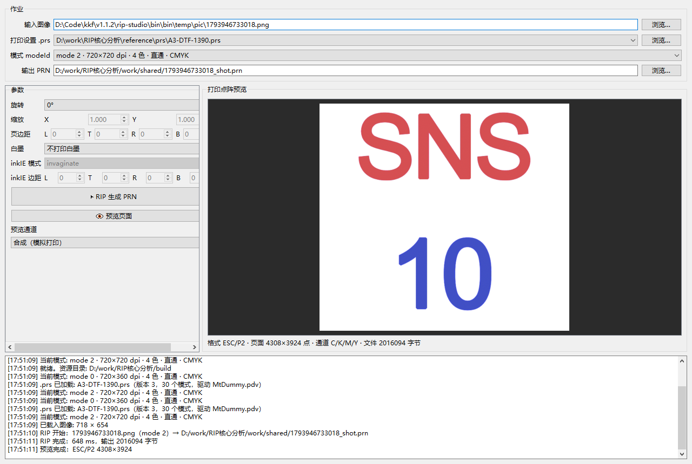

# 07 · mtr RIP Studio — Qt 可视化界面（GUI）

> 本文档介绍 `mtr_gui.exe`：把自研 RIP 引擎（`mtr_core`）包成桌面可视化工具。
> 与 `mtr_cli.exe` 使用**同一套 C++ 引擎**，不依赖蒙泰 SDK/DLL。



## 1. 功能

| 区域 | 功能 |
|---|---|
| 作业 | 选输入图像（PNG/JPEG/TIFF）、选 `.prs`（自动扫描 `build/prs`、`reference/prs`）、选 `modeId`（自动列出该 prs 的所有模式，含 dpi/色数/校色标记）、选输出 PRN 路径 |
| 参数 | 旋转 0°/180°（已实现，DTF 转印膜取向）；白墨 `不打印 / W1 full / W1 color`（已实现）；缩放、页边距、inkIE 为预留参数（界面置灰，引擎后续实现） |
| 预览 | 生成后自动解码 PRN 并显示**模拟打印效果**：合成色 / 原图 / 单通道（C/M/Y/K/W1/W2）；ESC/P2 与 HSSF 两种格式都支持；预览按内容区裁剪 |
| 日志 | 时间戳日志：`.prs` 解析、模式、图像载入、RIP 耗时、文件大小、预览结果 |
| 后台线程 | RIP 在后台线程执行，界面不卡死；完成后自动刷新预览 |

预览的合成规则是**近似减色模拟**（`R=255·(1-C)(1-K)` 等），用于检查版面/内容/颜色倾向，不是色度学精确打样。

## 2. 用法

```powershell
# 打开 GUI
build\mtr_gui.exe

# 无界面自检（CI/自动化）：生成 PRN + 预览 PNG
build\mtr_gui.exe --selftest <input> <prs> <modeId> <outDir>
#   输出：<outDir>/<name>_selftest.prn、preview_composite.png、preview_<C/M/Y/K>.png

# 自动载入并截图（文档/回归用）
build\mtr_gui.exe --screenshot <out.png> [input.prs] [prs] [modeId]
```

首次使用：`build\mtr_gui.exe` → 选择输入图 → 选择 `.prs`（默认已列出 `reference\prs\*.prs`）→ 选择模式 → 点「▶ RIP 生成 PRN」→ 自动显示预览。

## 3. 资源与部署

`build.cmd` 会自动部署：
- Qt6：`Qt6Core.dll / Qt6Gui.dll / Qt6Widgets.dll` + `platforms\qwindows.dll` + `imageformats\`（PNG/JPEG/TIFF）；
- 数据：`icc\`（颜色转换）、`screen\`（1024 加网 tile）、`color\`（灰度标定 LUT）、`prs\`（打印设置样例）。

手工部署到别的机器时，把上述目录放在 `mtr_gui.exe` 同目录即可（引擎通过 `core/resources.cpp` 以 exe/DLL 所在目录为资源基准）。

## 4. 限制（与 CLI 相同的已知边界）

- 遮罩/羽化（weave）未复刻：内容与蒙泰 oracle 约 0.1%~若干百分点的像素差异（打印等价）；
- 彩色图像未做 3D 色彩标定：跨色相颜色与蒙泰可能有差异（灰度轴已标定到 ±1 墨值）；
- 缩放 / 页边距 / inkIE：参数已接入作业模型，引擎暂未实现（界面置灰）；
- H13 板卡机（HSSF）：容器/头/白墨已复刻，内容级需 H13 专用探针数据；
- m5/m7/m9：加网 tile 未验证，引擎会打印告警。

## 5. 代码位置

- [src/gui/main.cpp](../src/gui/main.cpp)：入口 + `--selftest` / `--screenshot`
- [src/gui/mainwindow.h](../src/gui/mainwindow.h) / [mainwindow.cpp](../src/gui/mainwindow.cpp)：主窗口与交互
- [src/gui/previewrenderer.h](../src/gui/previewrenderer.h) / [previewrenderer.cpp](../src/gui/previewrenderer.cpp)：PRN 解码 + 打印点阵预览渲染
- 构建：`src/CMakeLists.txt` 的 `mtr_gui` 目标（Qt6 Widgets，AUTOMOC）


## 6. 已知问题与修复：生成后界面"卡住"

### 症状
生成 PRN 完成后界面无响应/光标一直显示"忙"。

### 根因（两处，已修复）
1. **预览在 GUI 主线程同步执行**：早期版本 RIP 线程结束后，直接在 GUI 线程解码 PRN
   （4308×3924 页面要建 4 张全尺寸平面 + 全尺寸通道图，耗时 1s+ 且期间事件循环被阻塞）；
2. **光标栈错误**：`setBusy(false)` 里成对 `setOverrideCursor/restoreOverrideCursor` 用法不对，
   每次生成都会在 Qt 光标栈里残留一个 `WaitCursor` ⇒ 之后光标永远是"等待"图标，看起来像卡死。

### 修复
- 预览改为**独立后台线程**（`PreviewThread`），解码+渲染不再阻塞事件循环；
- 预览渲染改为**按显示分辨率采样**（最长边 ≤1600），大图不再生成全尺寸 QImage；
  金样本预览耗时从 ~1s 降到 **352 ms**，720px 大图端到端从 3.9s 降到 2.3s；
- 光标改为只在 busy=true 时 push、busy=false 时 restore，成对平衡；
- 内容像素 > 40M（约 6600×6600）的超大图**自动跳过预览**并提示"PRN 本身已生成成功"，
  避免内存被打爆导致假死（实测 6600×6600：RIP 1.9s 完成，预览跳过，界面不卡）；
- 关闭窗口时若有后台任务未完成，会提示等待而不是强杀线程；
- 原图预览改用 ≤1600 的缩略图，避免大图切"原图"视图时反复缩放卡顿。

### 自检
```powershell
build\mtr_gui.exe --selftest reference\inputs\flat_black_720.png reference\prs\A3-DTF-1390.prs 2 work\shared\tmp
# 期望：RIP OK（~0.8s）+ 预览 OK（4320×4320）+ SELFTEST OK，总耗时 ~2.3s
```
